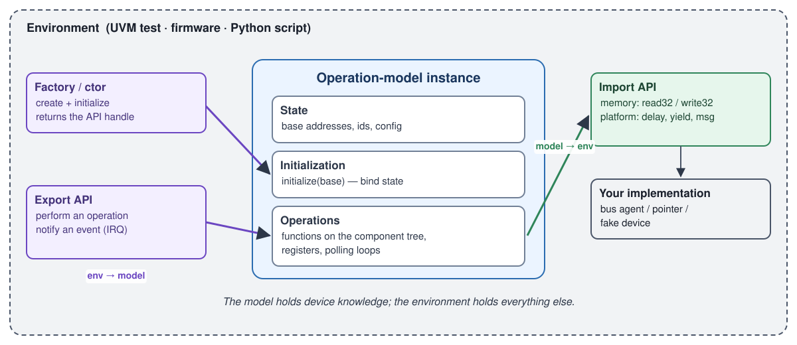
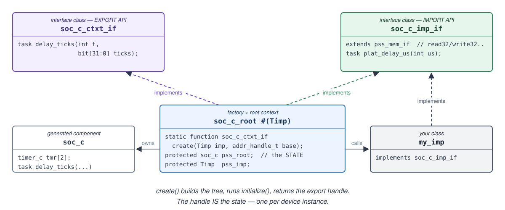
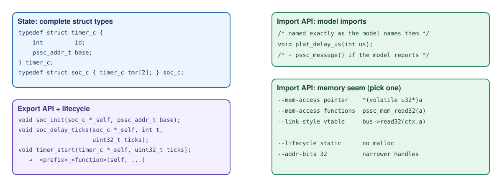

# Operation-model anatomy

```{button-link} slides/index.html#/getting-technical-operation-model-anatomy
:color: primary
:outline:

Slides for this section
```

## Four things an operation model provides



| Requirement | Purpose | In PSS |
|---|---|---|
| **Export API** | The environment calls in: perform an operation, notify the model of an event | `export target function f;` on the root component |
| **Import API** | The model calls out: memory access, platform services | `read32`/`write32`, `import target function` |
| **Initialization** | Bind state: base addresses, instance ids | `solve function void initialize(...)` |
| **State** | Per-instance data the operations read | component fields, register-group handles |

Everything else (scheduling, bus protocol, logging, test intent) stays in the
**environment**. The model never knows whether its `write32` is a UVM
sequence, a pointer dereference or a Python method.

## Language mappings

`pssc` generates each mapping in the idiom of its users. The four parts are
always there; what they look like depends on the language.

::::{tab-set}

:::{tab-item} SystemVerilog



- **Import API**: an interface class, `<root>_imp_if`, that *you* implement.
  It extends `pss_mem_if` (the memory accesses) and adds the model's own
  imports.
- **Export API**: an interface class, `<root>_ctxt_if`, that you call.
- **Initialization**: a factory, `<root>_root#(T)::create(imp, ...)`. It
  returns the export API; the returned handle holds the state.
- Operations are **tasks**, so a memory access may consume time.

```systemverilog
class my_imp implements soc_c_imp_if;          // IMPORT: you implement
  virtual task write32(addr_handle_t addr, bit [31:0] data);
    /* start a bus sequence, or call a uvm_reg backdoor ... */
  endtask
  virtual task read32(addr_handle_t addr, output bit [31:0] data); ... endtask
  virtual task plat_delay_us(input int us);  #(us * 1us);  endtask
endclass

initial begin
  my_imp        imp = new();
  soc_c_ctxt_if soc = soc_c_root#(my_imp)::create(imp, 64'h4000_0000);  // FACTORY
  soc.delay_ticks(1, 35);                                                // EXPORT
end
```
:::

:::{tab-item} C



- **Export API**: global functions, `<prefix>_<function>(self, ...)`.
- **Import API**: global functions the model calls and you define: the
  memory seam (`pssc_mem_read32`, ...) and the model's own imports.
- **Initialization**: `<prefix>_init(&self, ...)`.
- **State**: a struct. With `--lifecycle static` you own it, so there is no
  `malloc`.

```c
#include "soc.h"

/* IMPORT: memory seam (--mem-access functions) */
uint32_t pssc_mem_read32 (pssc_addr_t a)             { return *(volatile uint32_t *)a; }
void     pssc_mem_write32(pssc_addr_t a, uint32_t d) { *(volatile uint32_t *)a = d; }

/* IMPORT: the model's own imports */
void plat_delay_us(int us) { busy_wait_us(us); }

static soc_c soc;                       /* STATE: --lifecycle static, no malloc */

int main(void) {
    soc_init(&soc, 0x40000000u);        /* INIT */
    soc_delay_ticks(&soc, 1, 35);       /* EXPORT */
}
```
:::

:::{tab-item} Python and C++

Python (`op-model-py`) and C++ (`op-model-cpp`) follow the same shape: an
import **protocol** or interface, a root **class**, and a constructor that
takes the import object and the initialization arguments.

```python
class Env:                          # IMPORT: any object with these methods
    def read32(self, addr): ...
    def write32(self, addr, data): ...
    def plat_delay_us(self, us): ...

soc = Soc(Env(), 0x4000_0000)       # INIT; soc holds the state
soc.delay_ticks(1, 35)              # EXPORT
```

The Python import API is a `typing.Protocol`, so nothing has to inherit from a
generated class.
:::

::::

## Generator flavors

| `-t` | Output | Useful options |
|---|---|---|
| `op-model-sv` | package with `*_imp_if`, `*_ctxt_if`, `*_root` | `--package NAME` |
| `op-model-c` | `<prefix>.h/.c`, private `<prefix>_regs.h` | `--prefix`, `--link-style`, `--mem-access`, `--lifecycle static`, `--addr-bits 32`, `--yield import` |
| `op-model-cpp` | `<ns>.hpp`, header-only | `--namespace`, `--dispatch {virtual,template}` |
| `op-model-py` | `<module>.py` + `pssc_rt.py` | `--py-await {sync,async}` |
| *(all)* | | `--emit-manifest FILE` (JSON: ops, signatures, register offsets), `--no-comments` |

`pssc targets` lists them all. Each target also tells the model what it can
do through `target_cfg_pkg` (for example `HAVE_EVENT_WAIT`).

Next: {doc}`setup`, then Lab 1.
