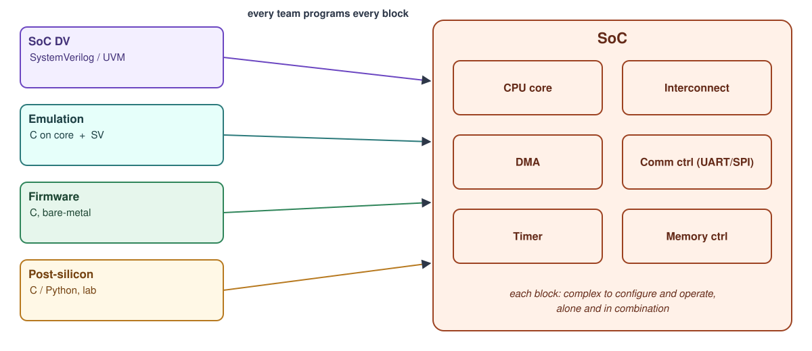
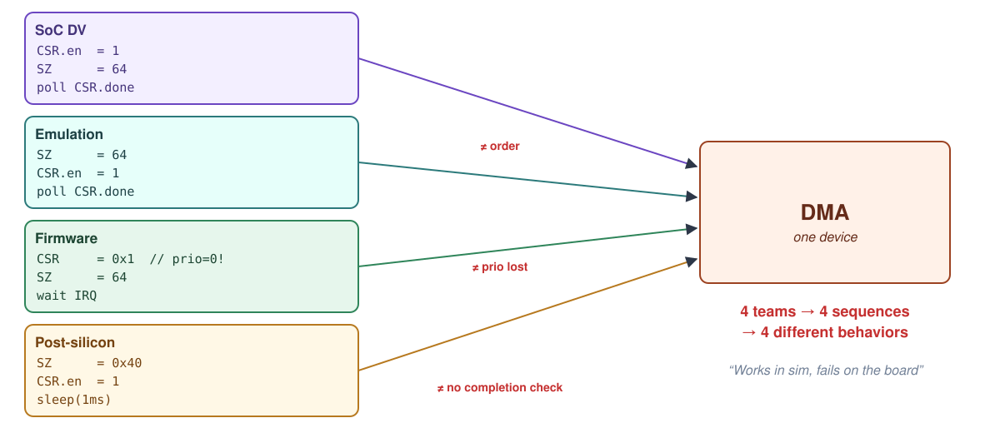
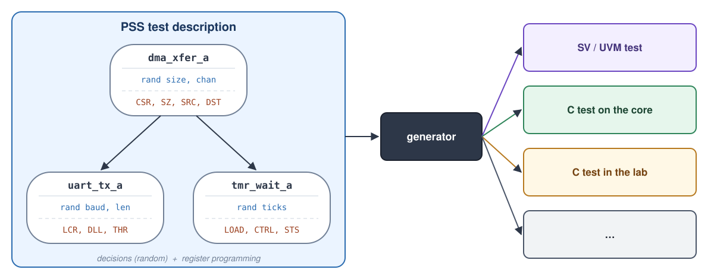
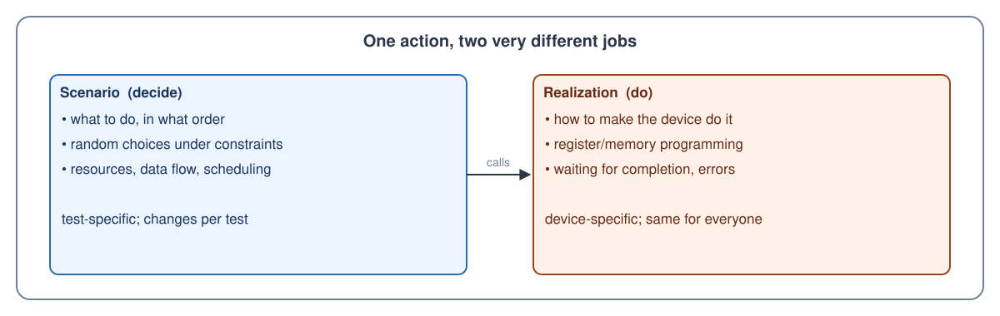
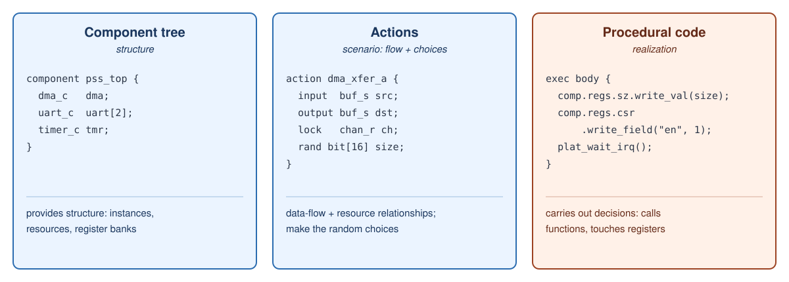
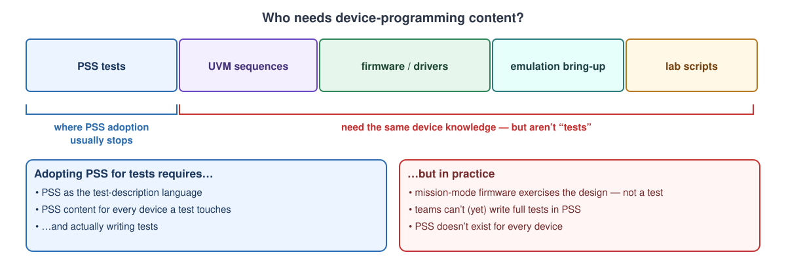
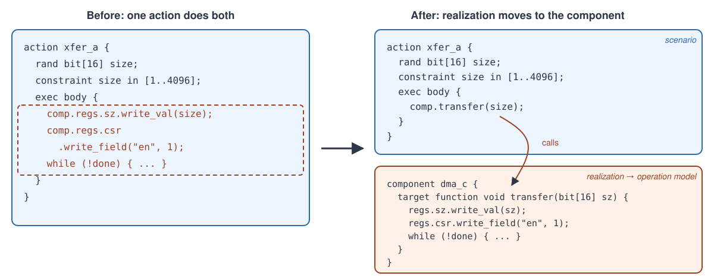
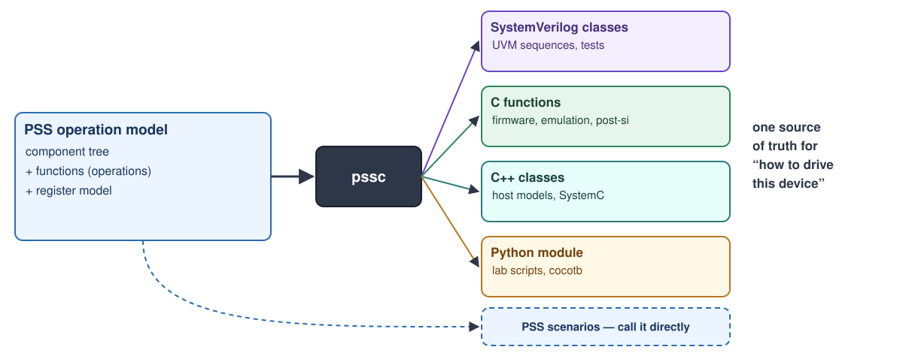

# Intro: what and why

```{button-link} slides/index.html
:color: primary
:outline:

Slides for this section
```

This page is the talk in prose, for reading after (or instead of) the
presentation.

## Integration needs consistent content

A system is built from many blocks (processor core, interconnect,
communication controllers), and each needs involved programming to configure
and operate, individually and in combination. The need shows up hardest on
the integration teams: SoC verification, emulation, firmware and
post-silicon.



Each team ends up writing its own version of the same programming sequences,
and those versions **drift**. One team tests one way, another a little
differently, and a small difference in configuration or programming makes the
device behave very differently. Drift is a major source of integration
headaches.



So the requirement is **consistent device-programming content, delivered in
several languages and methodologies**:

| Team | Language | What it needs |
|---|---|---|
| SoC DV | SystemVerilog / UVM | time-consuming tasks, sequencer-driven bus access |
| Emulation | C on the core, SV on the host | small footprint, fast |
| Firmware | C, bare-metal | no heap, no scheduler, `volatile` MMIO |
| Post-silicon | C / Python | scripting, lab debug, real hardware |

The device knowledge is the same in every row; the delivery requirements are
not.

## How far PSS gets us today

PSS is the visible solution for making **tests** portable: a PSS test
description goes through a generator and comes out as a test in one of many
languages.



Every action in such a test carries two different kinds of content:



- **Scenario / decision**: what to do, chosen with constraints and
  randomization.
- **Realization**: how to do it on this device: the register programming,
  the polling, the device-driver and device-utility code.

The PSS elements involved, briefly:



- The **component tree** provides structure.
- **Actions** define resource and data-flow relationships and make random
  choices.
- **Procedural code**, calling external functions and accessing registers and
  memory, carries out those decisions.

### What is a test?

- **Limited parameterization.** A seed and a few knobs, not an API.
- **Autonomous.** It exercises the design within the given parameters and
  checks as it goes.
- **Clear pass/fail.**

A test is one *consumer* of device knowledge, and not the most common one.

### Requirements versus reality



Adopting PSS for tests asks a team to use the PSS language for test
descriptions, to have (or create) PSS content for every device the test
touches, and to be creating *tests* in the first place. In practice:

- Teams don't always need tests. Mission-mode firmware exercises the design,
  but it isn't a test.
- A team may not be able, or willing, to write full tests in PSS.
- PSS content may not exist for every device.

## Taking PSS beyond test reuse

**Separate realization from scenario.** At this point it is a simple
separation: the scenario stays in the actions, and the realization moves into
functions on components, which the actions call.



Those component functions now form a **device-programming API**, and that API
can be generated on its own, for every language a team needs. That is the
**operation model**:



PSS scenarios still call the same functions directly, so nothing is lost for
the teams that do write PSS tests.

## Bottom line

- PSS gives us a **single source of truth** for device content that can
  target any language.
- Operation models pay off **immediately**, without waiting for anyone to
  write PSS tests.
- The more PSS content exists, the **easier PSS adoption** becomes for test
  scenarios later.

Next: {doc}`anatomy`.
