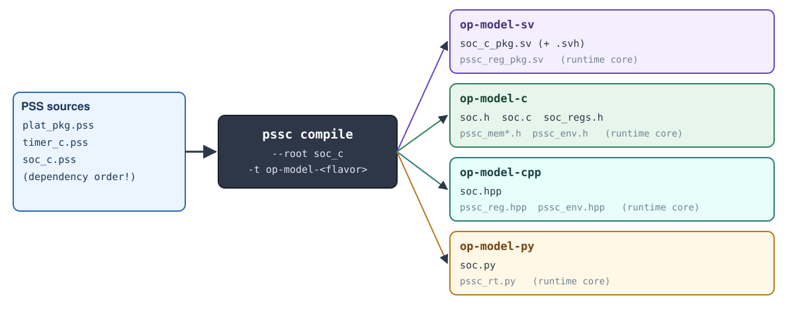
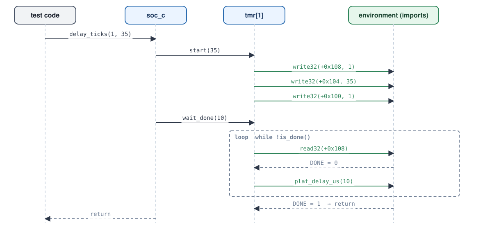

# Walkthrough

Work through these steps in order. Each one says what to run and what you
should see. All paths are relative to `labs/lab1`.

## Step 1: Look around

```console
$ cd labs/lab1
$ make help
```

```text
make gen       -- generate all four flavors into gen/<flavor>/
make run-c     -- build + run the C host harness
make run-sv    -- build + run the SystemVerilog harness (Verilator)
make run-py    -- run the Python harness
make run       -- all three
make clean
Add SOL=1 to any target to use the solution.
```

The operation model is the three files in `pss/`. Everything in `env/` is the
code a *user* of the model writes: one harness per language.

## Step 2: Read the model

Read the three files in the order `pssc` compiles them. As you go, find the
four parts every operation model has: **import API**, **state** and
**initialization**, **operations**, and the **export API**.

### Imports: what the model needs from its environment

```{literalinclude} ../../labs/lab1/pss/plat_pkg.pss
:language: pss
:caption: pss/plat_pkg.pss
```

- `import target function` declares a **platform service**. The model only
  names it; each environment supplies it.
- Memory access (`read32`/`write32`) is the other import. It is implicit: it
  comes from the standard `addr_reg_pkg`.
- Each generator turns imports into that language's "you implement this"
  form: a method on `soc_c_imp_if` in SystemVerilog, an `extern` prototype in
  C, a method on a `Protocol` in Python.

### A leaf component: one timer channel

```{literalinclude} ../../labs/lab1/pss/timer_c.pss
:language: pss
:caption: pss/timer_c.pss
:start-at: component timer_c
:emphasize-lines: 3-4,7-10,15-19
```

- **State** (`id`, `base`) is set once, at initialization, and read by every
  operation.
- **Initialization** is a `solve function`: it runs once, when the
  environment creates the model, and binds this instance to its address
  window.
- **Operations** are `target function`s. They access memory through
  `write32`/`read32` and call the platform import `plat_delay_us`.

### The root component and its export API

```{literalinclude} ../../labs/lab1/pss/soc_c.pss
:language: pss
:caption: pss/soc_c.pss
:start-at: component soc_c
:emphasize-lines: 2,5-9,18
```

- The **component tree** is the instance `tmr[2]`: two channels.
- The root's `initialize` initializes the children, each at its own offset.
- `delay_ticks` is a **composite operation**: it calls operations on a child.
- `export target function delay_ticks;` puts it in the **export API**, the
  functions the environment can call. The root is chosen on the command line
  (`--root soc_c`).

:::{tip}
The {doc}`reference` page documents this model with sphinx-pss:
{pss:comp}`soc_c`, {pss:comp}`timer_c` and {pss:func}`plat_pkg::plat_delay_us`.
:::

## Step 3: Generate

```console
$ make gen
```

This runs `pssc compile` once per flavor. The C one is:

```console
$ pssc compile pss/plat_pkg.pss pss/timer_c.pss pss/soc_c.pss \
       -t op-model-c --root soc_c -o gen/c \
       --link-style direct --mem-access functions --lifecycle static
```



You now have:

```text
gen/sv/    soc_c_pkg.sv (+ .svh files), pssc_reg_pkg.sv
gen/c/     soc.h, soc.c, pssc_*.h
gen/cpp/   soc.hpp, pssc_env.hpp, pssc_reg.hpp
gen/py/    soc.py, pssc_rt.py
```

## Step 4: Find the model in each flavor

Find `timer_c`'s `is_done` and `wait_done` in each generated flavor. The PSS
source is:

```{literalinclude} ../../labs/lab1/pss/timer_c.pss
:language: pss
:start-at: target function bool is_done()
:lines: 1-11
:dedent: 4
```

::::{tab-set}

:::{tab-item} SystemVerilog
```{literalinclude} ../../labs/lab1/gen/sv/timer_c.svh
:language: systemverilog
:caption: gen/sv/timer_c.svh
:start-at: virtual task is_done
:end-before: endclass
:dedent: 4
```

Operations are **tasks**, so a memory access may consume simulation time.
Because a task cannot return a value, `is_done`'s result becomes an `output`
**first argument**. Address arithmetic is folded: `base + 8`.
:::

:::{tab-item} C
```{literalinclude} ../../labs/lab1/gen/c/soc.c
:language: c
:caption: gen/c/soc.c
:start-at: uint8_t timer_is_done
:end-before: /* --- soc_c --- */
```

Each operation is a function `<component>_<operation>(self, ...)`. The
instance state is a struct (`timer_c`), declared in `soc.h`.
:::

:::{tab-item} C++
```{literalinclude} ../../labs/lab1/gen/cpp/soc.hpp
:language: cpp
:caption: gen/cpp/soc.hpp
:start-at: class timer_c
:end-before: class soc_c
```

Header-only. The import API is the abstract struct `soc_import_if`.
:::

:::{tab-item} Python
```{literalinclude} ../../labs/lab1/gen/py/soc.py
:language: python
:caption: gen/py/soc.py
:start-at: class Timer
:end-before: class Soc
```

The import object is passed to the constructor and kept as `self._imports`.
:::

::::

Notice that the comments in the PSS source are carried into every flavor.
`pssc --no-comments` drops them.

Now find the other parts of the model in each flavor: the state, `initialize`,
`delay_ticks`, the import `plat_delay_us`, and the instance array `tmr[2]`.

## Step 5: Run the three environments

```console
$ make run
```

Each environment does three things: implement the import API (here, with a
~40-line fake timer behind it), create the model, and call an exported
operation.

::::{tab-set}

:::{tab-item} C
```{literalinclude} ../../labs/lab1/env/c/main.c
:language: c
:caption: env/c/main.c (the use of the model)
:start-at: /* ---- The test
```

Output:

```{literalinclude} ../_build/generated/lab1/run-c.txt
:language: text
```
:::

:::{tab-item} SystemVerilog
```{literalinclude} ../../labs/lab1/env/sv/tb.sv
:language: systemverilog
:caption: env/sv/tb.sv (the use of the model)
:start-at: module tb;
```

Output:

```{literalinclude} ../_build/generated/lab1/run-sv.txt
:language: text
```
:::

:::{tab-item} Python
```{literalinclude} ../../labs/lab1/env/py/run.py
:language: python
:caption: env/py/run.py (the use of the model)
:start-at: env = FakeSoc()
```

Output:

```{literalinclude} ../_build/generated/lab1/run-py.txt
:language: text
```
:::

::::

**All three environments produce the same bus trace.** Same model, same bus
traffic: that is the point of the operation model.

## Step 6: Trace one call



Follow `delay_ticks(1, 35)` through the trace:

1. `start` clears DONE (`+0x8`), writes LOAD (`+0x4`) with 35 (`0x23`), and
   sets EN (`+0x0`). Channel 1 is at `0x40000100`.
2. `wait_done` polls STATUS, calling `plat_delay_us(10)` between polls. The
   fake timer advances 10 µs per call, so DONE is seen after 4 polls.

Next: {doc}`exercises`.
