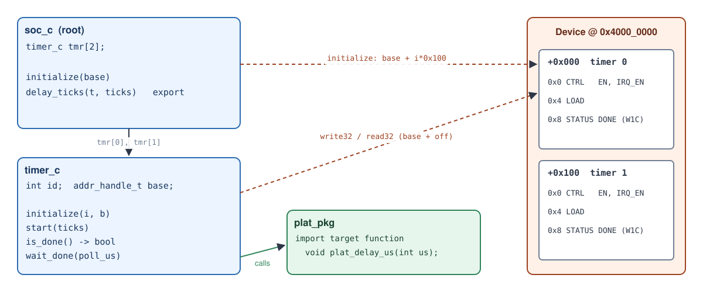
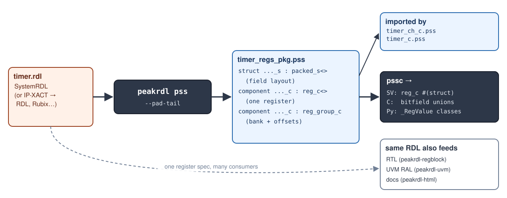
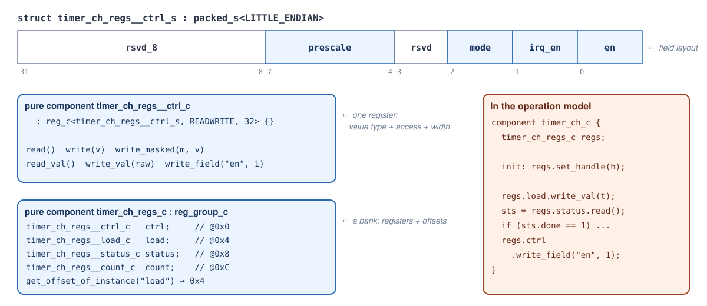
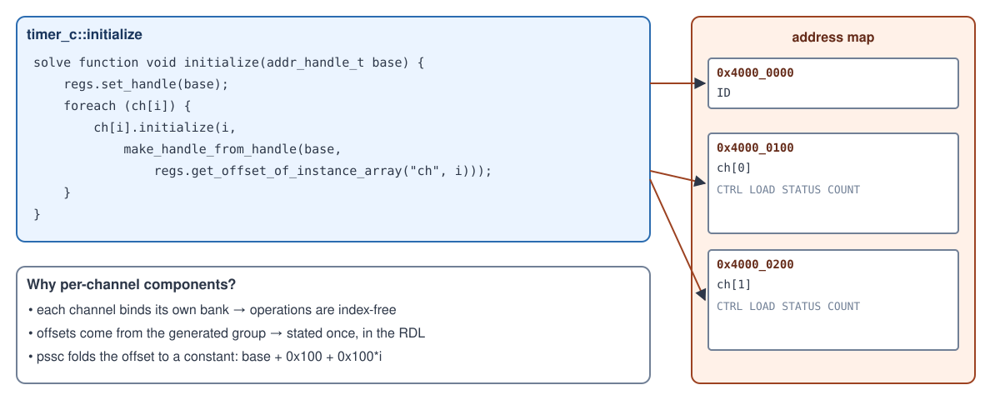
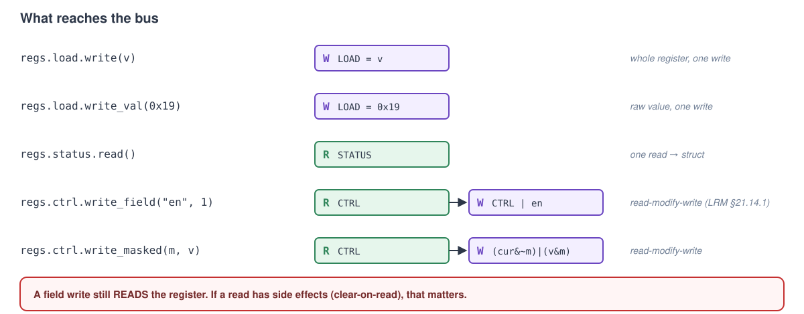
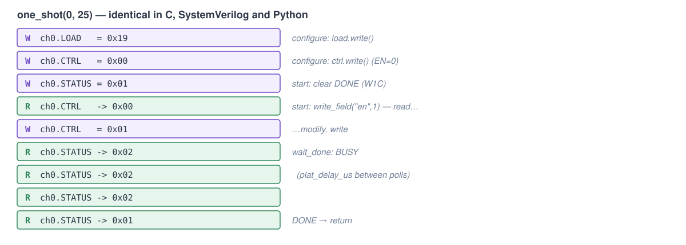

<!-- _class: lead -->
<!-- _paginate: false -->

# PSS Operation Models
## Hands-on: one device model → SystemVerilog, C, C++, Python

Matthew Ballance

<!--
Diagrams: diagrams/*.svg (regenerate with diagrams/render.sh).
Labs: labs/lab1, labs/lab2 (see labs/README.md).
-->

---

# Agenda

1. **Intro: what and why.** Integration, drift, and how far PSS gets us today
2. **Operation-model anatomy.** What an operation model has to provide, and how it maps to SV and C
3. **Lab 1: Core structure.** Component tree, initialization, export and import functions; generate and integrate
4. **Lab 2: Registers and memory.** Register models from SystemRDL; programming sequences

---

<!-- _class: divider -->
<!-- _paginate: false -->

# Intro: what and why

Integration and the need for consistent content

---

# Challenge 1: integration needs content


<!--
- Systems are composed of many design blocks: processor core, interconnect, comm controller...
- Each needs complex programming to configure and operate, individually and in aggregate.
- Most apparent on integration teams: SoC, emulation, firmware, post-silicon.
-->

---

# Challenge 2: drift


<!--
One team tests one way, another differently. One small config/programming difference
causes the device to behave very differently. Major cause of integration headaches.
-->

---

# Bottom line

We need **consistent device-programming content**, delivered in **several languages and methodologies**.

| Team | Language | What it needs |
|---|---|---|
| SoC DV | SystemVerilog / UVM | time-consuming tasks, sequencer-driven bus access |
| Emulation | C on the core, SV on the host | small footprint, fast |
| Firmware | C, bare-metal | no heap, no scheduler, `volatile` MMIO |
| Post-silicon | C / Python | scripting, lab debug, real hardware |

Same device knowledge, four different delivery requirements.

---

# PSS: the visible solution for portable *tests*


<!--
PSS test description -> generator -> test implemented in one of many languages.
Each action bubble carries randomization AND register programming.
-->

---

# Two key pieces in every action


**Scenario / decision** and **realization** (device driver, device utility).

---

# PSS elements, briefly


---

# What is a *test*?

- **Limited parameterization.** A seed and a few knobs, not an API
- **Autonomous.** Exercises the design within the given parameters and checks as it goes
- **Clear pass/fail**

A test is one *consumer* of device knowledge, and not the most common one.

---

# PSS adoption: requirements vs. reality


---

# Taking PSS beyond test reuse

**Separate realization from scenario.** At this point it's a simple separation:


---

# The operation model

The component functions now form a **device-programming API** we can generate:


PSS scenarios still call the same functions directly.

---

# Bottom line

- PSS gives us a **single source of truth** for device content that can target any language
- Operation models pay off **immediately**, without waiting for anyone to write PSS tests
- More PSS content available → **easier PSS adoption** for test scenarios later

---

<!-- _class: divider -->
<!-- _paginate: false -->

# Getting technical: operation-model anatomy

---

# Key requirements


---

# Four things an operation model must provide

| Requirement | Purpose | In PSS |
|---|---|---|
| **Export API** | the environment calls in: perform an operation, notify an event | `export target function f;` on the root |
| **Import API** | the model calls out: memory access, platform services | `read32`/`write32`, `import target function` |
| **Initialization** | bind state: base addresses, ids | `solve function void initialize(...)` |
| **State** | per-instance data the operations read | component fields, register-group handles |

Everything else (scheduling, bus protocol, logging, test intent) stays in the **environment**.

---

# SystemVerilog mapping


---

# SystemVerilog: what you write

```systemverilog
class my_imp implements soc_c_imp_if;          // IMPORT: you implement
  virtual task write32(addr_handle_t addr, bit [31:0] data);
    /* start a bus sequence, or call a uvm_reg backdoor ... */
  endtask
  virtual task read32(addr_handle_t addr, output bit [31:0] data); ... endtask
  virtual task plat_delay_us(input int us);  #(us * 1us);  endtask
endclass

initial begin
  my_imp        imp = new();
  soc_c_ctxt_if soc = soc_c_root#(my_imp)::create(imp, 64'h4000_0000);  // FACTORY
  soc.delay_ticks(1, 35);                                                // EXPORT
end
```

- Operations are **tasks**, so they may consume time
- One `create()` per device instance; the returned handle holds the state

---

# C mapping


---

# C: what you write

```c
#include "soc.h"

/* IMPORT: memory seam (--mem-access functions) */
uint32_t pssc_mem_read32 (pssc_addr_t a)             { return *(volatile uint32_t *)a; }
void     pssc_mem_write32(pssc_addr_t a, uint32_t d) { *(volatile uint32_t *)a = d; }

/* IMPORT: the model's own imports */
void plat_delay_us(int us) { busy_wait_us(us); }

static soc_c soc;                       /* STATE: --lifecycle static, no malloc */

int main(void) {
    soc_init(&soc, 0x40000000u);        /* INIT */
    soc_delay_ticks(&soc, 1, 35);       /* EXPORT: <prefix>_<function>(self, ...) */
}
```

Python (`op-model-py`) and C++ (`op-model-cpp`) follow the same shape: an import **protocol/interface**, a root **class**, and `create()` or a constructor.

---

<!-- _class: divider -->
<!-- _paginate: false -->

# Lab 1: Core structure

`labs/lab1`

---

# Lab 1 goals

- Describe an operation model in PSS:
  - a **component tree** holding **state**
  - an **initialization** function
  - **operations**, **exports** and **imports**
- Generate it with `pssc` in four flavors
- Integrate it into three environments: **C**, **SystemVerilog**, **Python**
- See that all three drive the device **identically**

---

# The device and the model



Two timer channels, raw register offsets for now (Lab 2 fixes that).

---

# PSS: imports (`pss/plat_pkg.pss`)

```pss
// What the operation model needs FROM its environment.
// The environment (UVM test, firmware, Python harness) implements these.
package plat_pkg {
    // Wait for (at least) 'us' microseconds of device time.
    import target function void plat_delay_us(int us);
}
```

- `import target function` declares a **platform service**. The model only names it.
- Memory access (`read32`/`write32`) is an implicit import, from `addr_reg_pkg`.
- Each generator turns imports into the language's *"you implement this"* form:
  - SV: a method on `soc_c_imp_if`
  - C: an `extern` prototype
  - Py: a method on a `Protocol`

---

<!-- _class: small -->

# PSS: a leaf component (`pss/timer_c.pss`)

```pss
component timer_c {
    // --- State: set once at initialization, read by every operation
    int            id;
    addr_handle_t  base;

    // --- Initialization: bind this instance to its address window
    solve function void initialize(int i, addr_handle_t b) {
        id   = i;
        base = b;
    }

    // --- Operations
    target function void start(bit[32] ticks) {
        write32(make_handle_from_handle(base, 0x8), 1);     // clear DONE
        write32(make_handle_from_handle(base, 0x4), ticks); // LOAD
        write32(make_handle_from_handle(base, 0x0), 1);     // EN
    }
    target function bool is_done() {
        bit[32] sts = read32(make_handle_from_handle(base, 0x8));
        return (sts & 1) != 0;
    }
    target function void wait_done(int poll_us) {
        while (!is_done()) { plat_delay_us(poll_us); }
    }
}
```

---

# PSS: the root (`pss/soc_c.pss`)

```pss
component soc_c {
    timer_c  tmr[2];

    solve function void initialize(addr_handle_t base) {
        foreach (tmr[i]) {
            tmr[i].initialize(i, make_handle_from_handle(base, i * 0x100));
        }
    }

    // A composite operation: start a timer and block until it expires.
    target function void delay_ticks(int t, bit[32] ticks) {
        tmr[t].start(ticks);
        tmr[t].wait_done(10);
    }

    // The API the environment sees.
    export target function delay_ticks;
}
```

- The **root** is chosen on the command line (`--root soc_c`)
- **Exports** select the root functions the environment can call. Sub-component functions remain reachable in C/C++/Py.

---

# Generating output


```sh
pssc compile pss/plat_pkg.pss pss/timer_c.pss pss/soc_c.pss \
     -t op-model-c --root soc_c -o gen/c \
     --link-style direct --mem-access functions --lifecycle static
```

---

# Available output flavors

| `-t` | Output | Useful options |
|---|---|---|
| `op-model-sv` | package with `*_imp_if`, `*_ctxt_if`, `*_root` | `--package NAME` |
| `op-model-c` | `<prefix>.h/.c`, private `<prefix>_regs.h` | `--prefix`, `--link-style`, `--mem-access`, `--lifecycle static`, `--addr-bits 32`, `--yield import` |
| `op-model-cpp` | `<ns>.hpp`, header-only | `--namespace`, `--dispatch {virtual,template}` |
| `op-model-py` | `<module>.py` + `pssc_rt.py` | `--py-await {sync,async}` |
| *(all)* | | `--emit-manifest FILE` (JSON: ops, signatures, register offsets), `--no-comments` |

`pssc targets` lists them all. Each target also tells the model what it can do via `target_cfg_pkg` (e.g. `HAVE_EVENT_WAIT`).

---

<!-- _class: small -->

# PSS → SystemVerilog

<div class="cols">

```pss
target function bool is_done() {
    bit[32] sts = read32(
        make_handle_from_handle(base, 0x8));
    return (sts & 1) != 0;
}

target function void wait_done(int poll_us) {
    while (!is_done()) {
        plat_delay_us(poll_us);
    }
}
```

```systemverilog
virtual task is_done(output bit status);
  bit [31:0] sts;
  pss_imp.read32((base + 8), sts);
  status = (sts & 1) != 0;
  return;
endtask

virtual task wait_done(input int poll_us);
  bit pssc_tmp_0;
  forever begin
    is_done(pssc_tmp_0);
    if (!(!(pssc_tmp_0))) break;
    pss_imp.plat_delay_us(poll_us);
  end
endtask
```

</div>

Return values become an `output` **first argument**, since operations are tasks. Address arithmetic is folded: `base + 8`.

---

<!-- _class: small -->

# PSS → C and Python

<div class="cols">

```c
uint8_t timer_is_done(timer_c *_self) {
    uint32_t sts = pssc_r32(pssc_bus(_self),
                            (_self->base + 8));
    return (sts & 1) != 0;
}

void timer_wait_done(timer_c *_self,
                     int poll_us) {
    while (!(timer_is_done(_self))) {
        plat_delay_us(poll_us);
    }
}
```

```python
class Timer(object):
    def __init__(self, imports: SocImportApi, i, b):
        self._imports = imports
        self.id = i
        self.base = b

    def is_done(self):
        sts = self._imports.read32((self.base + 8))
        return (sts & 1) != 0

    def wait_done(self, poll_us):
        while not (self.is_done()):
            self._imports.plat_delay_us(poll_us)
```

</div>

Comments in the PSS source are carried into every output (`--no-comments` to drop them).

---

# What happens at run time


---

# Environment integration

<div class="cols">
<div>

**SystemVerilog** (`env/sv/tb.sv`)
- class `implements soc_c_imp_if`
- `soc_c_root#(T)::create(imp, base)`
- `write32`/`read32` may consume time

**C** (`env/c/main.c`)
- define `pssc_mem_read32/write32`
- define `plat_delay_us`
- `static soc_c soc; soc_init(&soc, base);`

</div>
<div>

**Python** (`env/py/run.py`)
- any object with `read32`, `write32`, `plat_delay_us` (a `Protocol`, so no inheritance needed)
- `Soc(env, base)`

**All three** use a ~40-line *fake timer* behind the import API, so the lab runs on a laptop.

</div>
</div>

---

# Lab 1: run it

```sh
cd labs/lab1
make run                     # gen + run C, SV (Verilator), Python
make run PSSC_SRC=~/projects/psstools/pssc   # against a pssc source tree
```

```text
delay_ticks(1, 35)
  [bus] write32 0x40000108 = 0x1
  [bus] write32 0x40000104 = 0x23
  [bus] write32 0x40000100 = 0x1
done after 4 polls
```

**Same output from all three environments.** Same model, same bus traffic.

---

# Lab 1 exercises

1. **Observe.** `make gen`, then find each PSS element in `gen/sv`, `gen/c`, `gen/cpp`, `gen/py`:
   state, `initialize`, `delay_ticks`, `plat_delay_us`, `tmr[2]`
2. **Add an operation.** Give `timer_c` a `stop()` (EN=0, clear DONE); add and export `soc_c::cancel(int t)`.
   Regenerate: where did `cancel` appear in each flavor?
3. **Change a signature.** Give `wait_done` a `max_polls` budget and make it return `bool`; make `delay_ticks` return it.
   Update the three harnesses to report a timeout and call `cancel()`

Solution: `labs/lab1/solution`, run with `make run SOL=1`.

---

<!-- _class: divider -->
<!-- _paginate: false -->

# Lab 2: Registers and memory

`labs/lab2`

---

# Why a register model?

Lab 1 wrote `write32(make_handle_from_handle(base, 0x8), 1)`.

- **Offsets** are restated by hand, and wrong ones fail silently
- **Field positions and masks** are restated by hand
- **Access rules** (read-only, W1C) are invisible
- Every consumer (RTL, UVM RAL, firmware headers) has its own copy

PSS 3.x has a **register model** in `addr_reg_pkg`. Generate it from the same source as everything else.

---

# Creating register models



```sh
peakrdl pss rdl/timer.rdl --pad-tail -o pss/timer_regs_pkg.pss
```

---

# PSS register-model anatomy



---

<!-- _class: small -->

# Generated register package (excerpt)

```pss
package timer_regs_pkg {
    import addr_reg_pkg::*;

    struct timer_ch_regs__status_s : packed_s<LITTLE_ENDIAN> {
        bit done;       // [0] sw=rw hw=w reset=0x0 dropped: onwrite=woclr
        bit busy;       // [1] sw=r hw=w reset=0x0
        bit[30] rsvd_2; // [31:2] reserved
    }
    pure component timer_ch_regs__status_c : reg_c<timer_ch_regs__status_s, READWRITE, 32> {}

    pure component timer_ch_regs_c : reg_group_c {
        timer_ch_regs__ctrl_c   ctrl;
        timer_ch_regs__load_c   load;
        timer_ch_regs__status_c status;
        timer_ch_regs__count_c  count;

        pure function bit[64] get_offset_of_instance(string name) {
            match (name) { ["ctrl"]: return 0x0;  ["load"]: return 0x4;  /* ... */ }
        }
    }
}
```

`onwrite = woclr` has no PSS equivalent: peakrdl-pss warns (`PSS-W101`) and keeps it as a comment.

---

# Register and memory access functions

| Call | On | Bus effect |
|---|---|---|
| `read()` / `write(v)` | `reg_c<R>` | one access; value is the packed struct `R` |
| `read_val()` / `write_val(raw)` | `reg_c<R>` | one access; raw `bit[N]` |
| `write_field("en", 1)` | `reg_c<R>` | **read-modify-write** of one field |
| `write_masked(mask, v)` | `reg_c<R>` | **read-modify-write** |
| `set_handle(h)` | `reg_group_c` | none: binds the bank to an address (init only) |
| `get_offset_of_instance[_array]` | `reg_group_c` | none: folded to a constant by pssc |
| `read32(h)` / `write32(h, v)`, `8/16/64` | `addr_handle_t` | raw memory access (Lab 1) |
| `make_handle_from_handle(h, off)` | `addr_handle_t` | none: address arithmetic |

The field name in `write_field` is **resolved at compile time**, so a typo is an error rather than a wrong bit.

---

# Binding registers to addresses



---

<!-- _class: small -->

# The programming sequence (`pss/timer_ch_c.pss`)

```pss
component timer_ch_c {
    int              id;
    timer_ch_regs_c  regs;      // this channel's register bank

    solve function void initialize(int i, addr_handle_t bank) {
        id = i;
        regs.set_handle(bank);
    }

    target function void configure(timer_cfg_s cfg) {
        timer_ch_regs__ctrl_s ctrl;
        timer_ch_regs__load_s load;
        load.value = cfg.ticks;
        regs.load.write(load);
        ctrl.en = 0;  ctrl.irq_en = cfg.irq_en;            // build the value,
        ctrl.mode = cfg.periodic;  ctrl.prescale = cfg.prescale;
        regs.ctrl.write(ctrl);                              // then write it once
    }

    target function void start() {
        regs.status.write_val(1);         // DONE is write-1-to-clear
        regs.ctrl.write_field("en", 1);   // read-modify-write of one field
    }

    target function bool is_done() {
        timer_ch_regs__status_s sts = regs.status.read();
        return sts.done == 1;
    }
}
```

---

# Register-operation details



---

# Register-operation pitfalls

- **Field writes read first.** `write_field`/`write_masked` are a read-modify-write (PSS 3.1 §21.14.1). On a register with clear-on-read bits, that read **is** a side effect.
- **W1C registers.** Write the clear value with `write_val`. Don't RMW a W1C register, or you'll clear bits you didn't mean to.
- **Whole vs. field writes.** Build a struct and `write()` once when configuring. Use `write_field()` to flip one bit of live state.
- **Reserved bits.** Use `--pad-tail` so every struct spans the full register width. Otherwise C gets a `uint8_t raw` for a 32-bit register.
- **Device-specific semantics** (W1C, RC, sticky) aren't in the PSS type. Document them in the operation, where the next reader will look.

---

<!-- _class: small -->

# What it generates

<div class="cols">

```systemverilog
// SV: reg_c parameterized by the packed struct
class timer_ch_regs_c;
  reg_c #(timer_ch_regs__ctrl_s)   ctrl;
  reg_c #(timer_ch_regs__load_s)   load;
  reg_c #(timer_ch_regs__status_s) status;
  reg_c #(timer_ch_regs__count_s,
          READONLY)                count;
  ...
endclass

virtual task start();
  regs.status.write_val(1);
  regs.ctrl.write_field(
      TIMER_CH_REGS__CTRL_en, 1);
endtask
```

```c
/* C: bitfield unions, private header */
typedef union { uint32_t raw; struct {
    uint32_t en       :  1;
    uint32_t irq_en   :  1;
    uint32_t mode     :  1;
    uint32_t rsvd_3   :  1;
    uint32_t prescale :  4;
    uint32_t rsvd_8   : 24;
}; } timer_ch_regs__ctrl_s;

void timer_ch_start(timer_ch_c *_self) {
    timer_ch_regs_status_write_val(_self, 1);
    timer_ch_regs_ctrl_write_masked(
        _self, 1, 1);
}
```

</div>

---

# Lab 2: run it

```sh
cd labs/lab2
make regs        # SystemRDL -> pss/timer_regs_pkg.pss (checked in; needs peakrdl-pss)
make run
```



---

# Lab 2 exercises

1. **Change the register spec.** Add an `ovf` bit to `STATUS` in `rdl/timer.rdl` (bit 2, W1C: "expired again while DONE was set").
   `make regs gen` and find `ovf` in every flavor. You edited no PSS.
2. **Write a programming sequence.** Add `timer_ch_c::ack()` (read STATUS, clear DONE|OVF, return `ovf`) and
   `timer_c::periodic(int c, bit[32] ticks, int n)` → number of missed expiries. Export it.
3. **Explain the trace.** Run `periodic(1, 20, 3)` and `periodic(1, 4, 2)`. Why does the second miss expiries?
   Which bus accesses come from `write_field`?

Solution: `labs/lab2/solution`, run with `make run SOL=1`.

---

# Wrap-up

- An **operation model** is PSS's device knowledge, separated from scenarios
- **Four parts:** export API, import API, initialization, state
- **`pssc`** turns one model into SV, C, C++ and Python, each idiomatic for its users
- **Register models** come from the register spec (SystemRDL → `peakrdl pss`), not from hand-typed offsets
- Payoff today: **every team runs the same programming sequence**. Payoff later: PSS tests reuse the same functions.

